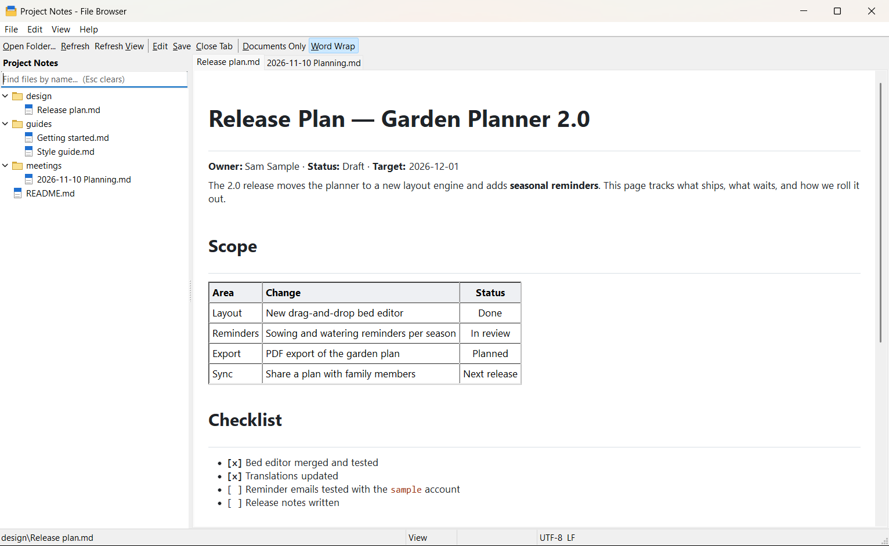

# File Browser

A light Windows app for browsing a folder and reading or editing its Markdown files.

It exists for one job: keeping a folder of notes, plans or reviews open next to your main
editor without running a second full editor window. Pick a folder, click a file, and it opens
formatted; press **Ctrl+E** to edit it.



## Features

- **Folder tree** like a code editor's, with find-by-name and a *Documents Only* filter
  (`.md`, `.txt`, `.pdf`).
- **Formatted Markdown view:** headings, lists and task lists, tables, code blocks, quotes,
  links (relative links to other Markdown files open in a new tab). *Keep Line Breaks*
  (View menu, on by default) shows each line break in a paragraph as a new line, the way
  GitHub comments do; turn it off for standard Markdown, where lines run together.
- **Editor** with Markdown highlighting, word wrap and line numbers. Other text files (SQL,
  C#, JSON, XML, Python, Pascal, …) open with syntax highlighting.
- **Tabs:** open as many files as you like.
- **Live reload:** files changed on disk reload by themselves, keeping your scroll position.
  New files appear in the tree within a few seconds.
- **Remembers where you were:** reopens the last folder with the same tabs and expanded
  folders, kept separately for each folder.
- **Works across monitors** with different display scaling; *Refresh View* (Ctrl+R) redraws on
  demand.
- **Optional "Open in File Browser"** on the right-click menu of folders in File Explorer.

## Install

Run `FileBrowser-Setup-<version>.exe`, from the repository's Releases page or built yourself
(see below). It installs for your Windows user without admin rights; the first page also
offers an install for all users.

## Keyboard shortcuts

| Keys | Action |
|---|---|
| Ctrl+O | Open a folder |
| Ctrl+E | Switch a Markdown file between the formatted view and editing |
| Ctrl+S / Ctrl+Shift+S | Save / save all |
| Ctrl+N | New Markdown file |
| Ctrl+W / Ctrl+Shift+W | Close tab / close all (middle-click also closes a tab) |
| Ctrl+Tab / Ctrl+Shift+Tab | Next / previous tab |
| Ctrl+F, F3 | Find in the file, find next |
| Ctrl+Shift+E | Show the open file in the tree |
| Ctrl+Shift+D | Documents only |
| F5 | Refresh the tree and unchanged files |
| Ctrl+R | Refresh View: redraw the open documents |
| Alt+Z | Word wrap in the editor |
| Ctrl+Plus / Ctrl+Minus / Ctrl+0 | Zoom in / out / reset |
| F1 | Show these shortcuts |

## Build from source

Requirements:

- [Lazarus](https://www.lazarus-ide.org/) 4.x with Free Pascal 3.2.2, 64-bit Windows. The
  packages used (LCL, SynEdit, TurboPowerIPro) come with Lazarus.
- For the installer: [Inno Setup 6](https://jrsoftware.org/isinfo.php).
- To redraw the icon: Python 3 with Pillow.

```bash
lazbuild FileBrowser.lpi
```

or open `FileBrowser.lpi` in the Lazarus IDE and press F9. To build the exe and the installer
in one step (output in `installer\Output\`):

```bash
powershell -ExecutionPolicy Bypass -File installer\build-installer.ps1
```

The main window is built in code (`umain.pas`), the Markdown converter is `umarkdown.pas` and
the editor's Markdown highlighter is `usynmarkdown.pas`.

## Settings

Settings are kept per user in `%LOCALAPPDATA%\FileBrowser\FileBrowser.ini`: window size, zoom,
the last folder, and for each folder its open tabs and expanded folders. Uninstalling leaves
the file, so a reinstall carries on where you left off. Delete it to start fresh.

## Limitations

- Windows only.
- Emoji show as plain shapes, not in colour.
- Images in Markdown show as a link that opens the image, not inline.
- Find (Ctrl+F) searches in the editor, so the formatted view switches to editing to show a
  match.

## Licence

GNU General Public License v3.0 — see [LICENSE](LICENSE).
